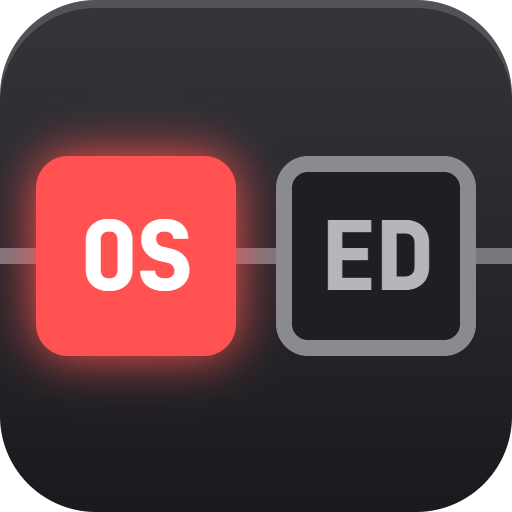

<p align="center"></p>

# oshexed

An open-source desktop editor for the **Line 6 Helix LT**: presets, snapshots, assignments, Command Center, IR
slots and the unit's global settings, live over USB. It also builds and flashes **modded firmware** from your own
stock firmware file, with extra blocks such as a NAM capture player and a MIDI Guitar.

> **Not affiliated with Line 6.** "Line 6", "Helix" and "HX Edit" are trademarks of their owners and are used only
> to describe compatibility. oshexed contains no Line 6 code or data: it reads models, presets and graphics at
> runtime from your own firmware file.

## Modified firmware: risks and recovery

Modified firmware is unofficial and at your own risk. Line 6 won't support problems caused by it. You can always
go back to stock firmware, and you should before any service request.

**Update mode** starts before the firmware does, so it works even when a build doesn't boot. Switch the unit off,
then hold these while switching it on:

| Unit | Hold |
|---|---|
| Helix Floor / LT | footswitches 6 and 12 (Mode and Tap) |
| Helix Rack | encoders 1 and 6 pressed down (the two outermost) |

Then flash the official firmware, with oshexed or with Line 6's own updater. Update mode needs firmware 1.06.5 or
later on the unit. Check that it starts on your unit before you flash a modded build, and keep your stock firmware
file at hand.

Presets that use mod blocks only work on modded firmware; on stock firmware those blocks are dropped. HX Edit
doesn't know mod blocks either, so back such presets up as `.hxp` or export them from oshexed.

More on update mode and the other power-on options: [Line 6 Knowledge Base: reset procedures and
troubleshooting](https://kb.line6.com/helix-rack-lt-fx-stomp-reset-procedures-and-troubleshooting-tricks).

## Status

- **Unit:** Helix LT only. Other Helix models are recognised and load with a warning.
- **Firmware:** 3.80.0 (stock, or a build made from it with oshexed). Other versions load with a warning.
- **Platform:** Windows. Linux and macOS are planned; the editor itself is portable, the USB link is not yet.
- **Stage:** in active development and used on real hardware, but not a finished product. Keep backups.

## What it does

**Presets**
- Setlists and presets from the unit (or offline from a firmware file), signal flow with paths 1A/1B/2A/2B, split
  and merge, the unit's own block icons and DSP usage per path.
- Model browser with the unit's categories and lists, block parameters, linked amp/cab, inputs and outputs.
- Snapshots (name, colour, tempo, copy/paste), Bypass / Controller Assign (EXP pedals, footswitches, MIDI CC,
  snapshots, Variax knobs), Command Center with per-snapshot values.
- Edits go to the unit live. Save, Save as, rename, reorder, copy/paste, undo/redo.
- HX Edit `.hlx` import and export; backups of single presets or whole setlists as `.hxp` (the unit's own bytes).

**The unit**
- Global EQ and Global Settings.
- IR slots: import a WAV, rename, clear. Neural Amp Modeler captures (`.nam`) can be converted and loaded into IR
  slots for the NAM block of a modded firmware; the IR list tells captures and IRs apart.
- Firmware: identifies stock firmware and our own builds, and flashes a firmware file with a rehearsal against a
  simulated unit first.

**Mods**
- Lists the mod packages made for your exact stock firmware, downloads the ones you choose, and builds a modded
  firmware file next to your stock one, with a report of everything that changed.
- The stock file is never modified. Flashing is a separate, confirmed step.

**Monitor**
- USB traffic between the editor and the unit, and MIDI input with decoded debug values.

**Command line**
- The same functions without a window (see below).

## Getting started

1. Install Line 6's driver for the Helix (it comes with HX Edit). oshexed talks to the unit through it and changes
   nothing about the driver setup.
2. Get your stock firmware file (`.hxf`) for your unit, as downloaded by Line 6's updater. oshexed reads the models,
   names, graphics and factory presets from it.
3. Start oshexed and open the `.hxf` (or drop it on the window).
4. Connect the Helix by USB and switch it on. Close HX Edit and the Line 6 Updater first: only one program can talk
   to the unit at a time.

Nothing is written to the unit without an action of yours. Preset saves follow the "Ask before saving" setting;
IR imports, renames and clears, and every firmware flash, always ask first and name what they replace.

## Mods

Mod packages (`.ohem`) come from a module server, by default <https://bixxy.net/oshexed/>. Each package is made
for one exact stock firmware (unit, version and image hash); oshexed only offers packages that match your file and
checks each download's size and SHA-256. Packages can also be dropped on the window; those are marked as not
coming from the server.

A package never contains Line 6 bytes. It describes changes ("this block is the stock model X with these
differences", "expect these stock bytes here", "put our code there"), and oshexed applies them to your own file.
Every build is checked before it is saved (stock models, browser lists and costs still intact, new DSP modules
valid), and gets a build tag that the unit shows on its Global Settings screen.

## Command line

`oshexed.exe` is also a command-line tool: with a command it runs it and exits, without one it opens the editor.

```
oshexed [FILE.hxf | PRESET.hlx]                      the editor
oshexed --info FILE.hxf                              version, unit, stock or one of our builds, checks
oshexed --lists | --presets | --snapshots | --gfx FILE.hxf
oshexed --model FILE.hxf TEXT                        models whose name or symbol contains TEXT
oshexed --modules STOCK.hxf [--fetch [ID...] | --import FILE.ohem]
oshexed --build STOCK.hxf --mods ID,ID|PKG.ohem... [-o OUT.hxf]
oshexed --flash FILE.hxf [--fast] [--keep-presets|--rebuild-presets] [--simulate] [--yes]
oshexed --flash-sim FILE.hxf                         rehearsal against a simulated unit
oshexed --device-info | --unit | --settings ID...    read-only queries of the connected unit
oshexed --ir-read SLOT [-o FILE]                     read-only: an IR slot's samples
oshexed --convert FILE.nam [-o OUT.wav]              NAM capture -> IR-slot .wav
oshexed --hlx FILE.hxf PRESET.hlx                    an HX Edit preset as the editor reads it
oshexed --export-hlx FILE.hxf SLOT|PRESET.hlx        a preset as an HX Edit file, on stdout
```

`oshexed --help` lists everything, including developer checks. Exit code 0 means success; errors print one line
on stderr. `--flash` writes to the unit and asks for confirmation on the terminal unless `--yes` is given.

## Where it keeps its files

`%APPDATA%\oshexed\oshexed\`: `settings.ini`, the build history (`builds.txt`), what was last flashed
(`unit_state.txt`), a cache of the unit's IR slot contents (`ir_kinds.txt`) and downloaded mod packages
(`modules\`). Modded firmware builds are saved next to your stock firmware file.

## Building

Requirements:
- CMake 3.22 or newer and a C++20 compiler. On Windows: [w64devkit](https://github.com/skeeto/w64devkit)
  (MinGW-w64 GCC) with Ninja. The executable embeds its UI files with the assembler's `.incbin`, so GCC or Clang;
  MSVC builds copy them next to the executable instead.
- The [Luminoveau](https://github.com/bXi/luminoveau) engine (SDL3, RmlUi). Point `LUMINOVEAU_DIR` at a checkout,
  or put one at `./luminoveau` or `../luminoveau`.
- Internet access when configuring: the engine fetches its dependencies, and oshexed fetches zlib, miniz and the
  Lucide icon font, each pinned by version and SHA-256.

```
cmake -S . -B build -G Ninja -DCMAKE_BUILD_TYPE=Release -DLUMINOVEAU_DIR=C:/path/to/luminoveau
cmake --build build
ctest --test-dir build
```

The result is a single `build/frontend/oshexed.exe` with its licence files next to it.

| Option | Default | |
|---|---|---|
| `HXED_BUILD_APP` | `ON` | The editor (needs Luminoveau). Off: only `core` and the tests. |
| `HXED_BUILD_CLI` | `ON` | The command line inside `oshexed.exe`. |
| `HXED_BUILD_TESTS` | `ON` | `core_tests`: unit tests with synthetic data, no firmware needed. |
| `OSHEXED_EMBED_ASSETS` | `ON` | Pack `ui/` and `assets/` into the executable. Off: copy them next to it. |

## Project layout

```
core/       no UI and no engine: firmware reading (.hxf, models, graphics, presets), the preset writer, .hlx,
            the mod builder, USB device link and editor protocol, NAM and IR conversion
cli/        the command-line commands
frontend/   the app: one view per tab, RmlUi data bindings
ui/         main.rml and theme.rcss
assets/     the app icon (the engine adds its shaders here at configure time)
tests/      core_tests
```

## Licence

MIT, see [LICENSE](LICENSE). Third-party parts: the Lucide icon font (ISC, `LICENSE-lucide.txt` next to the
executable), zlib (zlib licence), miniz (MIT), and Luminoveau with its own dependencies, listed in
`THIRD_PARTY_NOTICES.txt` next to the executable.
